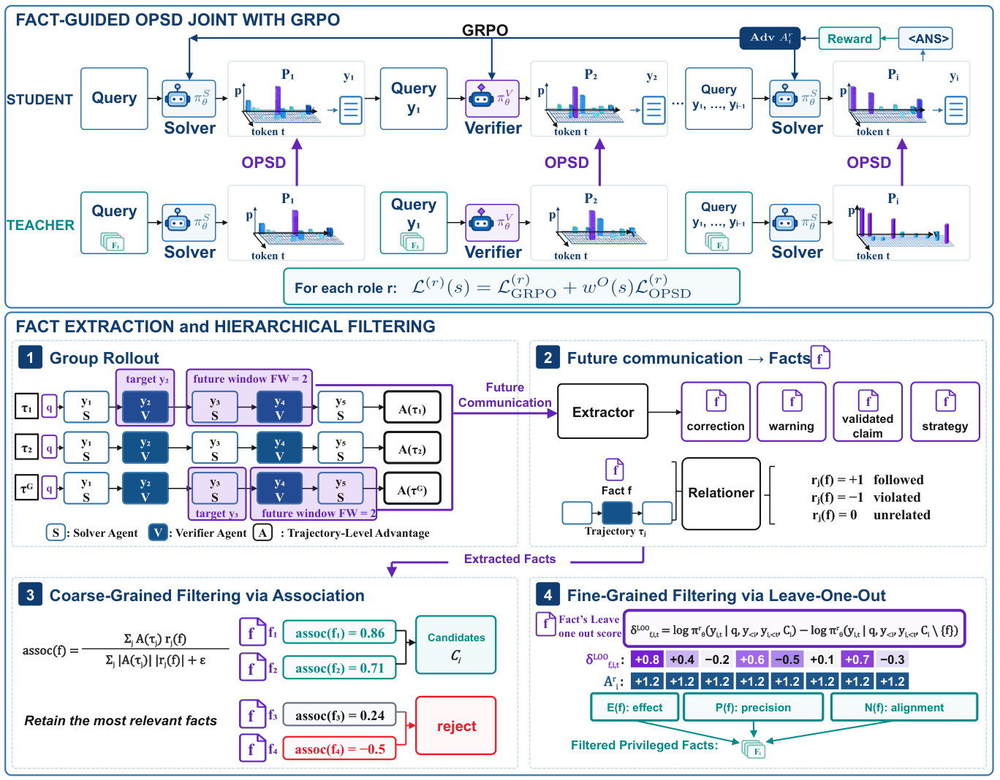
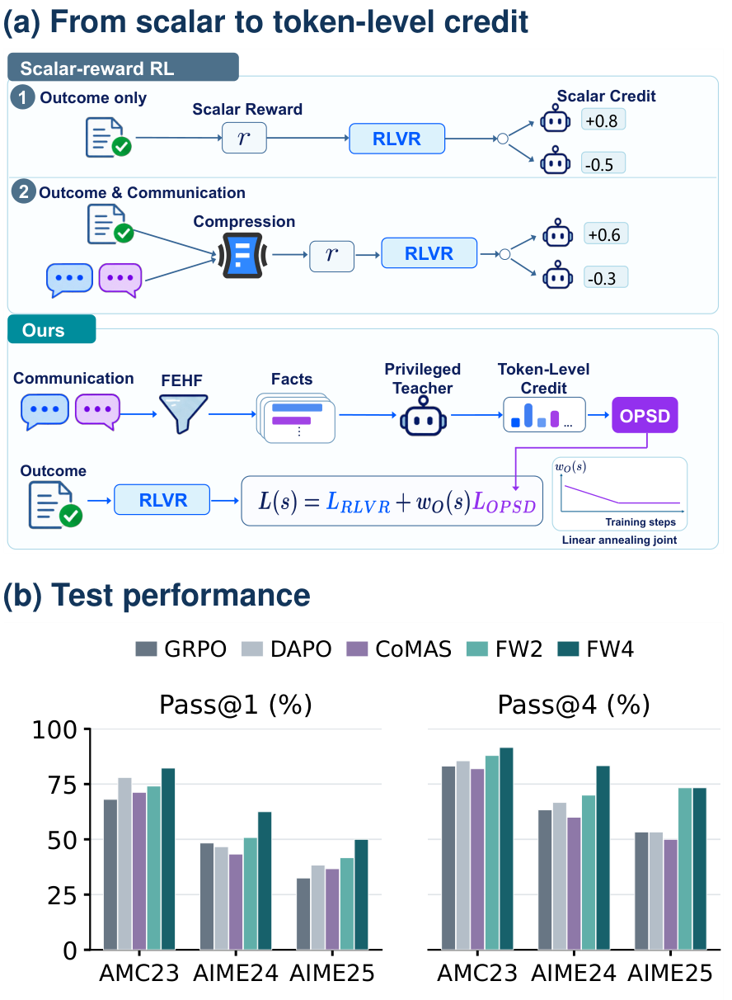

<div align="center">

# OPSD4MAS

### Turning Multi-Agent Communication into Token-Level Credit<br>with On Policy Self Distillation

**Learn from what agents say next. Improve what each agent learns now.**

[](LICENSE)
[](https://huggingface.co/Qwen/Qwen3-4B)
[](#quick-start)
[](#reference-configuration)

[Method](#method) · [Results](#main-results) · [Quick start](#quick-start) · [Evaluation](#evaluate-on-six-benchmarks) · [中文指南](docs/GETTING_STARTED_zh.md)

</div>

OPSD4MAS turns future communication in a multi-agent system into **token-level learning signals**. An external model extracts mathematical facts and labels their relations to same-query trajectories. Association ranking and target-specific leave-one-out filtering select useful facts. The current role policy, conditioned on those facts, supplies privileged teacher scores for on-policy self-distillation alongside agent-wise GRPO.

**At inference time, agents use ordinary contexts. Future information and the external extraction model are not required.**

<table>
<tr><td align="center"><strong>+8.87 pp</strong><br>Mean pass@1 over GRPO</td><td align="center"><strong>+9.54 pp</strong><br>Mean pass@4 over GRPO</td><td align="center"><strong>6 benchmarks</strong><br>Qwen3-4B role policies</td></tr>
</table>

*Paper-reported FW4 results, with equal weights across datasets. This release has not rerun the full training experiment.*

## Method

<p align="center"><a href="assets/framework.pdf"></a></p>

1. **Extract communication knowledge.** Collect atomic corrections, warnings, validated claims and strategies from a future window of four responses.
2. **Filter for relevance and influence.** Rank facts using their association with trajectory outcomes, then test their token-level leave-one-out influence against the target response's agent-wise outcome advantage.
3. **Learn with two complementary signals.** Combine GRPO outcome guidance with fact-conditioned OPSD credit, decreasing the OPSD loss weight linearly during training.

The student and privileged teacher are two context views of the **same role policy**. The external model constructs facts and relations; it does not provide teacher logits. Solver and Verifier have separate trainable policies.

<details>
<summary><strong>Why communication-derived token credit?</strong></summary>

<p align="center"><a href="assets/motivation.pdf"></a></p>

Communication can identify a specific error or repair that a scalar task reward does not describe. OPSD4MAS uses selected future information during training to guide the probabilities of tokens the agents actually generated.

</details>

## Main results

Each cell is **pass@1 / pass@4 (%)** from manuscript Table 1. Each pass@4 attempt is a complete trajectory ending in a final answer, rather than a different agent within one interaction.

| Method | AMC23 | AIME24 | AIME25 | MATH-500 | Olympiad | Minerva |
|:--|--:|--:|--:|--:|--:|--:|
| Base Model | 60.24 / 74.70 | 25.83 / 43.33 | 19.17 / 23.33 | 82.40 / 90.40 | 41.04 / 53.04 | 24.72 / 31.99 |
| Solver–Verifier MAS | 56.63 / 71.08 | 22.50 / 36.67 | 16.67 / 26.67 | 83.50 / 91.80 | 46.81 / 59.26 | 33.27 / 41.18 |
| AFlow | 61.44 / 77.11 | 27.50 / 46.67 | 22.50 / 26.67 | 79.15 / 88.60 | 45.44 / 58.07 | 30.61 / 39.34 |
| GPTSwarm | 61.44 / 74.70 | 20.83 / 36.67 | 20.83 / 30.00 | 80.75 / 89.60 | 44.33 / 54.22 | 24.72 / 34.19 |
| DrMAS-GRPO | 68.07 / 83.13 | 48.33 / 63.33 | 32.50 / 53.33 | 90.95 / 94.60 | 56.11 / 68.30 | 36.76 / 42.65 |
| DrMAS-DAPO | 78.01 / 85.54 | 46.67 / 66.67 | 38.33 / 53.33 | 90.35 / 94.40 | 58.93 / 68.00 | 36.86 / 43.75 |
| CoMAS | 71.29 / 81.93 | 43.33 / 60.00 | 36.67 / 50.00 | 90.90 / 94.20 | 56.59 / 68.44 | 36.40 / 41.18 |
| OPSD4MAS (FW2) | 74.10 / 87.95 | 50.83 / 70.00 | 41.67 / 73.33 | 89.00 / 95.20 | 55.59 / 67.11 | 38.42 / 47.06 |
| **OPSD4MAS (FW4)** | **82.23 / 91.57** | **62.50 / 83.33** | **50.00 / 73.33** | **91.50 / 96.60** | **60.30 / 69.93** | **39.43 / 47.79** |

FW4 denotes a future window of four responses. Olympiad is the English text-only mathematics subset of OlympiadBench. These are the paper's reported values, not fresh outputs from this repository. The retained math grader has dataset-dependent limitations, especially for Minerva; see [evaluation protocol](docs/EVALUATION.md).

[Machine-readable JSON](results/paper-main-results.json) · [CSV](results/paper-main-results.csv) · [Code and experiment provenance](docs/REPRODUCIBILITY.md)

## What this release includes

- The complete FW4 path: Solver–Verifier rollout, fact extraction, Association/LOO filtering, teacher scoring, and annealed joint OPSD–GRPO updates.
- Portable four-GPU launchers with foreground output, saved logs, explicit resume, and non-destructive output checks.
- Data normalization and identity checks for the six paper benchmark snapshots.
- Six-benchmark evaluation with saved token IDs, responses, trajectory outcomes and reproducible pass@1/pass@4 aggregation.

Training code for comparison baselines and the full ablation/injection study are outside this release. Framework components needed by the retained training stack remain vendored under their original import paths.

## Quick start

Use a Linux x86_64 CUDA machine with **four 80GB GPUs** and sufficient host RAM for offloaded training states. The commands below start from the root of this repository. First obtain the repository through your chosen hosting service; no public repository URL has been assigned yet.

### 1. Create the environment

```bash
conda create -n opsd4mas python=3.10 -y
conda activate opsd4mas
python -m pip install --upgrade pip
python -m pip install torch==2.6.0 torchvision==0.21.0 --index-url https://download.pytorch.org/whl/cu124
python -m pip install -r requirements.txt
python scripts/install_flash_attention.py
python -m pip install -e . --no-deps
python -m pip check
python scripts/check_environment.py
```

The FlashAttention installer looks for an official wheel matching Python, PyTorch and C++ ABI; it stops if none is available rather than silently starting a source build. Installation and four-GPU training still require validation on the target Linux machine. [Environment details and troubleshooting](docs/INSTALLATION.md).

### 2. Download the base model

```bash
python -c "from huggingface_hub import snapshot_download; snapshot_download('Qwen/Qwen3-4B', local_dir='data/models/Qwen3-4B')"
```

### 3. Prepare the data

Provide the original DAPO training Parquet and the **paper-format six-benchmark snapshot**, arranged as `AMC23/test.parquet`, `AIME24/test.parquet`, and so on. See [data sources, identities and validation](docs/DATA.md) before substituting another dataset version.

```bash
export TRAIN_SOURCE=/path/to/dapo-math-17k.parquet
export BENCHMARK_SOURCE=/path/to/six-benchmark-snapshot
python scripts/prepare_data.py --train-source "$TRAIN_SOURCE" --test-source "$BENCHMARK_SOURCE" --output data/prepared
```

The preparer deduplicates DAPO by source ID and checks 17,917 unique training problems. Benchmark counts must be **83 / 30 / 30 / 500 / 675 / 272**, with matching question/answer identities. Benchmark contents are not redistributed in this repository. The historical reference validation combines the first three benchmarks and is **not an independent held-out set**; supply `--validation-source /path/to/independent-validation.parquet` for independent checkpoint selection.

### 4. Configure the training API

Copy the example and fill in your provider's endpoint, JSON-capable model and this job's quota allocation. Keep credentials out of versioned files.

```bash
cp .env.example .env.local
# Edit .env.local with your provider settings and API key.
set -a
source .env.local
set +a
```

Extraction and relation calls share this job's limiter, including retries. Other jobs and servers using the same account must receive separate shares of the provider quota. The external model and API behavior are part of the experimental configuration. [API configuration](docs/API.md).

### 5. Check and start FW4

```bash
export CUDA_VISIBLE_DEVICES=0,1,2,3
python scripts/check_environment.py --inputs --gpu
# Inspect the command without loading models, calling the API, or creating a run.
env -u BASH_ENV bash scripts/train_fw4.sh configs/fw4.env --dry-run
# Formal foreground training; status and logs stay visible in this terminal.
env -u BASH_ENV bash scripts/train_fw4.sh configs/fw4.env
```

Each launch creates a new directory under `outputs/` and prints its path. It saves `console.log`, resolved launch settings, package versions, checkpoints, validation predictions and fact artifacts. Existing output directories are never overwritten. No GPU filler or background queue is launched.

### Resume training

```bash
env -u BASH_ENV bash scripts/train_fw4.sh configs/fw4.env --resume-from /path/to/global_step_100
```

Use a complete trusted checkpoint with both role policies, model/optimizer/extra-state shards and `data.pt`. Keep the four-GPU world size and algorithm configuration compatible. Resume writes to a new output directory and retains the source checkpoint.

## Reference configuration

| Setting | Public FW4 reference |
|:--|:--|
| Backbone and mode | Qwen3-4B, non-thinking |
| Roles and allocation | Independent Solver and Verifier policies, colocated on 4 × 80GB GPUs |
| Question batch / trajectory repeats | 32 / 8 |
| Interaction | Up to `Solver → Verifier → Solver → Verifier → Solver`, with early termination |
| Future window / candidate cap / selected cap | 4 / 10 / 8 |
| Extracted facts per source / LOO variant chunk | 12 / 32 |
| LOO thresholds | effect ≥ 0.02, precision ≥ 0.50, net alignment > −0.001 |
| Prompt / response / teacher total-context budgets | 8192 / 4096 / 8192 tokens |
| Actor micro / scoring micro, per GPU | 2 / 8 |
| Generation backend / tensor parallelism | SGLang / 1 |
| Generation static memory fraction | 0.5, including model weights and KV pool |
| Training memory | Gradient checkpointing, remove padding, parameter and optimizer offload |
| Updates | Adaptive mini-batch, one update partition, PPO epoch 1, learning rate 1e−6 |
| Loss reduction | GRPO response mean; OPSD token mean |
| OPSD loss weight | `max(0.1 − 0.0004 × step, 0.02)` |
| PowerOPD | Disabled |

`configs/fw4.env` exposes the runtime settings; environment variables override the profile. The public fresh run defaults to 550 steps and two dataset epochs. It is not a replay of the original step-20 continuation. Training settings recovered from historical records and later operational changes are distinguished in [reproducibility notes](docs/REPRODUCIBILITY.md).

## Evaluate on six benchmarks

Evaluation uses the ordinary Solver–Verifier contexts and requires **no external API**. Specify a complete four-rank FSDP checkpoint and keep the original base model tokenizer available. The historical evaluation profile uses prompt/response limits of 14336/6144, four trajectories per question, temperature 0.6 and top-p 0.95.

```bash
export CUDA_VISIBLE_DEVICES=0,1,2,3
env -u BASH_ENV bash scripts/evaluate.sh --checkpoint /path/to/global_step_100 --datasets all --dry-run
env -u BASH_ENV bash scripts/evaluate.sh --checkpoint /path/to/global_step_100 --datasets all
```

To evaluate a subset:

```bash
env -u BASH_ENV bash scripts/evaluate.sh --checkpoint /path/to/global_step_100 --datasets AMC23 AIME24 AIME25
```

The terminal prints per-dataset results and a final table. Each dataset receives a separate log, `predictions/predictions.jsonl` and `result.json`; the run root contains `results.json` and `results.md`. To recompute metrics from retained predictions:

```bash
python scripts/evaluation_records.py /path/to/predictions.jsonl --questions 83
```

## Repository map

```text
configs/          Public FW4 profile
scripts/          Environment, data, training and evaluation entry points
agent_system/     Role policies, interaction and math environment
verl/             Vendored distributed training implementation
assets/           Paper figures and source identity
results/          Paper-reported main results
examples/         Retained data normalization helpers
tests/           Method and release-entry tests
docs/            Installation, API, data, evaluation and reproduction notes
```

## Validation and provenance

[Validation report](docs/VALIDATION.md) records exactly which checks have run. CPU/static validation does not establish CUDA execution, API access, throughput or full-run numerical reproduction. [File-level provenance](docs/source-provenance.json) identifies the retained snapshot and the public-release changes.

## Acknowledgments and license

This implementation builds on [Dr.MAS](https://github.com/langfengQ/DrMAS), [verl](https://github.com/volcengine/verl), [SGLang](https://github.com/sgl-project/sglang), [FlashAttention](https://github.com/Dao-AILab/flash-attention) and [Qwen3](https://huggingface.co/Qwen/Qwen3-4B). Original copyright notices and the Apache-2.0 [license](LICENSE) are retained. Dataset and model licenses remain with their respective providers.

The manuscript's final author list, arXiv identifier and public repository address will be added when assigned. This candidate does not invent citation metadata or redistribute the anonymous manuscript.
